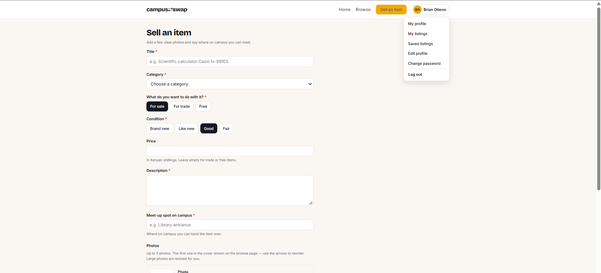
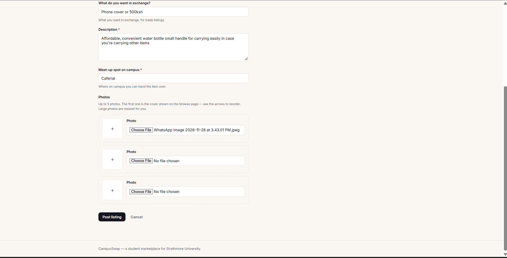
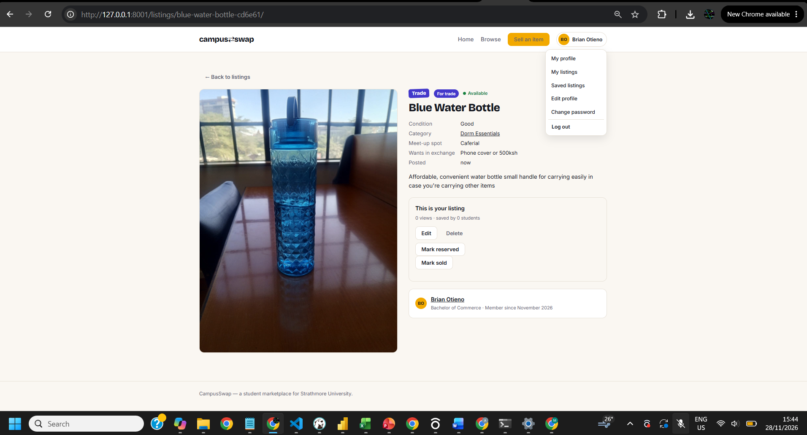
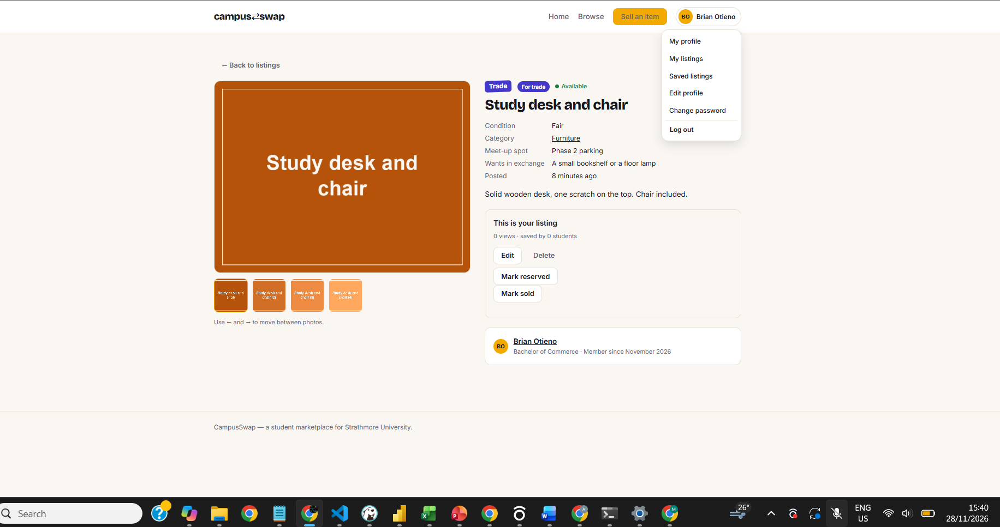
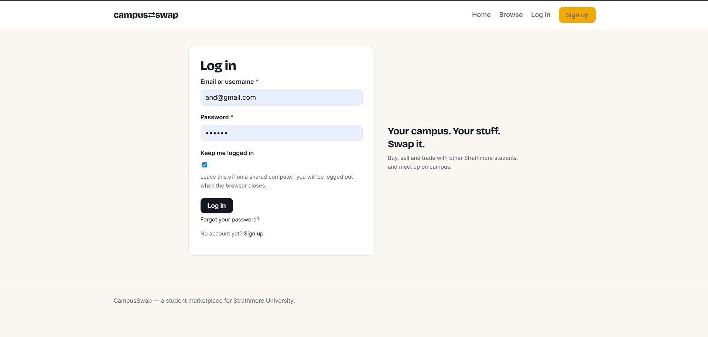
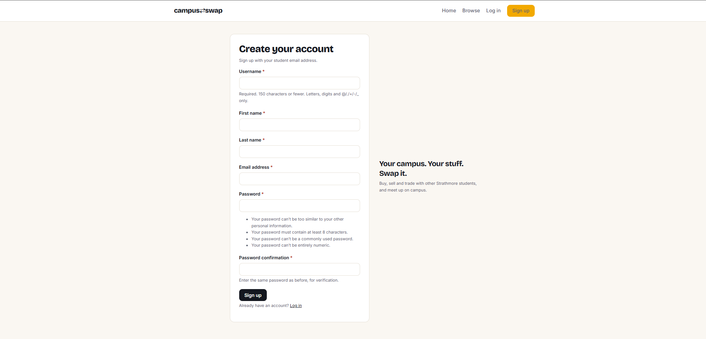
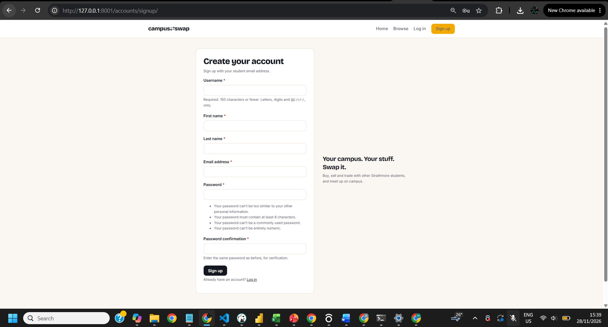
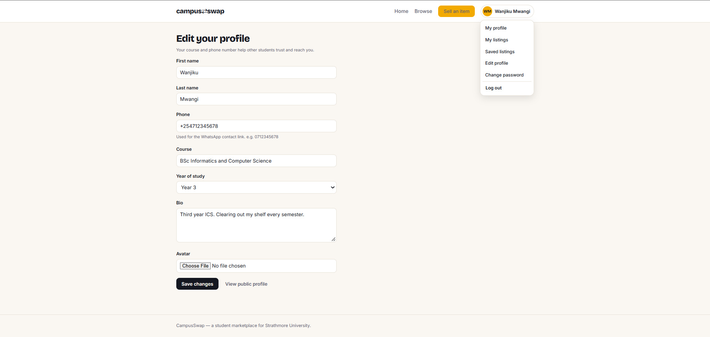
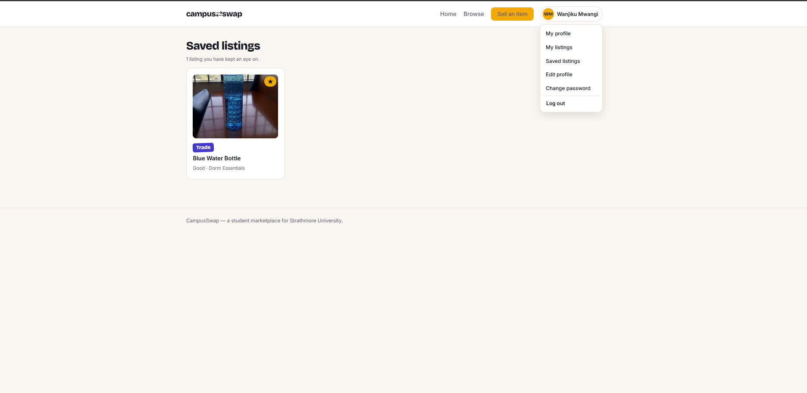
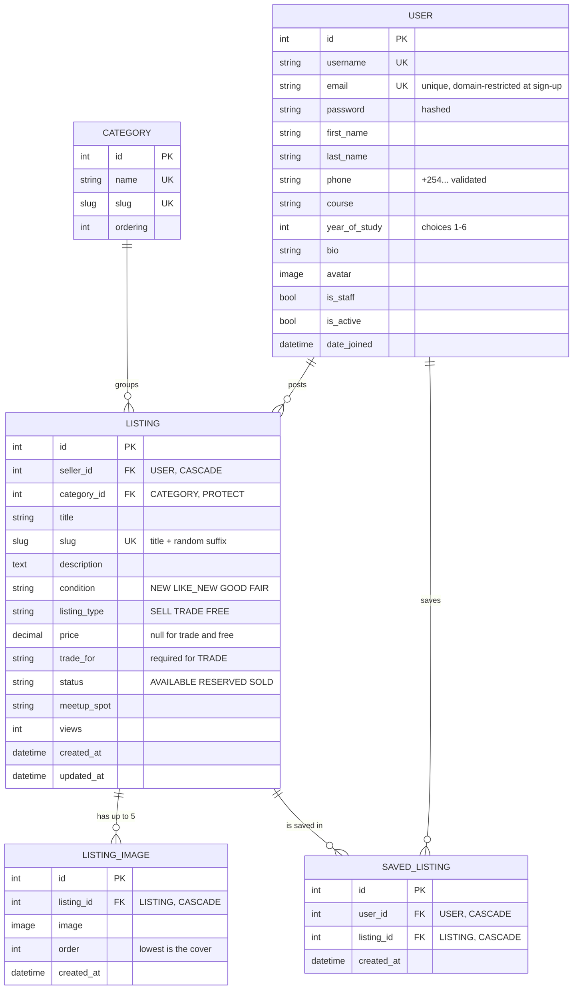

# CampusSwap
A student-only marketplace for Strathmore University.

Individual semester project for BBT 3101 (Internet Programming with Django)
by Andrew Karanja (167144).

## Screenshots

### Posting and viewing an item
**Sell an item:** listing form with category, condition and listing type (ModelForm)


**Trade details and photos:** trade field plus up to five photos (inline formset)



**Listing detail:** photo gallery, price tag, seller card and contact button



**Owner view:** the seller's panel to edit, delete and mark an item reserved or sold



### Accounts
**Log in:** email or username, with a "keep me logged in" option (session expiry)



**Sign up:** restricted to Strathmore email addresses



**Running locally:** the sign-up page served by the Django dev server



**Edit profile:** phone, course, year of study, bio and avatar



### Saved listings
**Saved items:** listings a student has starred to come back to



## What it is

**The problem.** Every semester ends with students holding textbooks, calculators, hotplates and
furniture they no longer need, and starts with other students buying the same things new. The usual
option is a WhatsApp group where posts scroll away within minutes, nothing is searchable, and there
is no way to tell who is still active or what an item actually looks like.

**Who it is for.** Strathmore students. Sign-up is restricted to a configured email domain
(`strathmore.edu` by default), so the whole marketplace is people who can meet on campus — which is
also why every listing has to name a meet-up spot.

**What they can do.** A student signs up with their university email and fills in a short profile.
They post an item with up to five photos, a category, a condition, a campus meet-up spot and one of
three listing types — **sell** (with a price in KSh), **trade** (saying what they want in exchange)
or **free**. Other students browse or search the board, filter by category, type, condition and
price, save listings they are interested in to come back to, and contact a seller on WhatsApp to
arrange the hand-over. The seller marks the item Reserved and then Sold without deleting it, so
their own listing page doubles as a record of what moved.

## Stack

- Python 3.12+, Django 6.1
- SQLite in development (PostgreSQL planned for deployment)
- Server-rendered Django templates, one hand-written CSS file, no build step
- Django REST Framework + drf-spectacular for the JSON API and its OpenAPI docs
- Pillow for image handling, python-dotenv for settings

## Features

**Accounts and authentication**

- Sign up restricted to configured email domains (default `strathmore.edu`), with a friendly error
- Log in with **either** email address or username, case-insensitively
- "Keep me logged in" controls how long the session lasts
- Logout as a POST form (Django 5+ removed GET logout)
- Password change and the full four-step password reset flow (email to the console in development)
- Public student profile (avatar or initials, course, year, bio, member since, their listings) and a
  private profile editor

**Marketplace**

- Post a listing with photos, category, condition, meet-up spot and a Sell / Trade / Free type
- Price rules per type: selling needs a price, trading needs what you want in exchange, free has no price
- Up to five photos per listing through an inline formset, reordered by arrow buttons or dragging;
  the first photo is the cover shown on cards
- Every upload is downscaled to 1600px and re-encoded without EXIF metadata (so no stray GPS data)
- Listings with no photos (the API cannot take uploads) show a labelled placeholder block, never a
  broken image
- Listing detail page with a photo gallery (thumbnails, arrow-key navigation, `<dialog>` lightbox),
  the price tag, badges, seller card and a WhatsApp contact link for logged-in students
- Edit, delete and mark a listing Available / Reserved / Sold — owner only
- "My listings" with status tabs and counts
- **Save a listing** from any card or the detail page and find it again at `/saved/`; the seller sees
  how many students have saved their item
- `/browse/` — search across title and description, filter by category, type, condition and price
  range, sort by newest or price, 12 per page with the filters kept across pages, removable
  active-filter chips, and a filter sidebar that becomes a bottom sheet on mobile
- Category pages at `/c/<slug>/` reuse the same view, with the category fixed by the URL
- Sold items are hidden by default, with an "Include sold items" toggle
- Home hero search and category chips feed straight into the browse page
- A per-visitor "Recently viewed" strip driven by the session
- View counter that does not count the owner's own visits

**REST API**

- `/api/v1/` — categories (read-only) and listings (search, filter, paginate, retrieve, and
  create/edit/delete your own), JSON only
- The same search form drives the API filters and the browse page, and the same
  `Listing.clean()` enforces the Sell / Trade / Free price rules, so the two interfaces cannot
  drift apart
- Session cookie or API token (`POST /api/v1/auth/token/`, then `Authorization: Token <key>`)
- Interactive Swagger UI at **<http://127.0.0.1:8000/api/docs/>**, served from the project's own
  static files so it needs no exception in the Content-Security-Policy

**Admin and demo data**

- Custom user admin with the student profile fields
- Listing admin with thumbnails, filters, search, inline status editing and the photo gallery
  as a `TabularInline`
- Seven categories seeded by a data migration, plus a `seed_demo` command that generates
  placeholder photos with Pillow

**Security** (the full write-up is in [SECURITY.md](SECURITY.md))

- Ownership enforced in the queryset, CSRF on every POST, login rate limiting, validated `next`
  redirects, uploads identified by content rather than file extension, and a Content-Security-Policy
  with per-response nonces instead of `unsafe-inline`


## Course concepts coverage

| Concept                                                | Where it is in this project                                                                                                                                                                                                                                                                                                                                                                                                                                                                                                                                                                                                                                                                                     |
| ------------------------------------------------------ | --------------------------------------------------------------------------------------------------------------------------------------------------------------------------------------------------------------------------------------------------------------------------------------------------------------------------------------------------------------------------------------------------------------------------------------------------------------------------------------------------------------------------------------------------------------------------------------------------------------------------------------------------------------------------------------------------------------- |
| **HTML / CSS**                                         | `templates/base.html` (nav, toast region, footer), the page templates in `templates/` and `<app>/templates/<app>/`, shared partials in `templates/includes/` (`form_field.html`, `listing_card.html`, `save_button.html`, `no_photo.html`); one hand-written stylesheet, `static/css/app.css` — CSS variables for the design tokens, CSS grid for the listing grid (`repeat(auto-fill, minmax(240px, 1fr))`), a mobile hamburger nav and a bottom-sheet filter panel under 768px, `prefers-reduced-motion` respected. `static/css/admin-extras.css` does the same job for the admin thumbnails.                                                                                                                 |
| **Django (project structure, views, URLs, templates)** | `config/` holds settings, the root URLconf and shared helpers (`config/forms.py`, `config/redirects.py`); apps are `accounts`, `products` and `api`. Class-based views for CRUD in `products/views.py` (`ListingListView`, `ListingDetailView`, `ListingCreateView`, `ListingUpdateView`, `ListingDeleteView`, `MyListingsView`, `SavedListingsView`) and function views for the small POST-only actions (`mark_status`, `toggle_save`). Namespaced URLs (`products:`, `accounts:`, `api:`) in `products/urls.py`, `accounts/urls.py`, `api/urls.py`; template inheritance from `templates/base.html`; a custom context processor in `products/context_processors.py`; `django.contrib.humanize` for the dates. |
| **Forms (incl. formsets)**                             | `products/forms.py` → `ListingForm` (`ModelForm`), `ListingSearchForm` (plain `forms.Form` driving GET search, filtering and sorting), `ListingImageForm` + `BaseListingImageFormSet` + `listing_image_formset_class()` — an **inline formset** built with `inlineformset_factory(..., can_order=True, can_delete=True, max_num=5, validate_max=True)`, saved by `PhotoFormsetMixin` in `products/views.py`. `accounts/forms.py` → `SignUpForm(UserCreationForm)`, `LoginForm(AuthenticationForm)`, `ProfileForm`, with field-level validation in `clean_email()` and `clean_avatar()`. `config/forms.py` → `FormStyleMixin` styles every widget; `templates/includes/form_field.html` renders every field.     |
| **Database / models**                                  | `accounts/models.py` → `User(AbstractUser)` with `AUTH_USER_MODEL = "accounts.User"`. `products/models.py` → `Category`, `Listing` (`TextChoices` for condition/type/status, `DecimalField` price, slug built in `save()`, `Meta.ordering` and two `models.Index` entries), `ListingImage` (one-to-many gallery), `SavedListing` (the user ↔ listing join table, with a `UniqueConstraint` on the pair). Migrations in `products/migrations/`, including the data migration `0002_seed_categories.py` and the gallery move in `0004_move_cover_image_to_gallery.py`. Management command: `products/management/commands/seed_demo.py`.                                                                           |
| **CRUD**                                               | Create: `ListingCreateView` (`/listings/new/`). Read: `ListingListView` (`/browse/`, `/c/<slug>/`), `ListingDetailView` (`/listings/<slug>/`), `MyListingsView`, `SavedListingsView`. Update: `ListingUpdateView` (`/listings/<slug>/edit/`) and `mark_status` for the Available/Reserved/Sold switch. Delete: `ListingDeleteView` (`/listings/<slug>/delete/`). `toggle_save` creates and deletes `SavedListing` rows. The same four operations over JSON in `api/views.py` → `ListingViewSet`.                                                                                                                                                                                                                |
| **Authentication**                                     | `accounts/views.py` → `signup()`, `CampusLoginView`, `ProfileUpdateView`; `accounts/backends.py` → `EmailOrUsernameBackend` (log in with email **or** username); Django's `LogoutView`, `PasswordChangeView` and the four password-reset views wired in `accounts/urls.py`; `LoginRequiredMixin` on every private view; ownership in `products/views.py` → `OwnerListingMixin.get_queryset()` (filtered by `seller=request.user`, so a non-owner gets a 404).                                                                                                                                                                                                                                                   |
| **Sessions**                                           | `SessionMiddleware` with database-backed sessions (`config/settings.py`); `LoginForm.remember_me` + `CampusLoginView.form_valid()` calling `request.session.set_expiry(0)` or `set_expiry(None)` against `SESSION_COOKIE_AGE`; the "recently viewed" strip in `products/views.py` → `remember_viewed()` / `recently_viewed_listings()` storing listing ids under the `recently_viewed` session key; the messages framework (session-backed) rendered as toasts in `templates/base.html`.                                                                                                                                                                                                                        |
| **Security**                                           | `config/tests_security.py` is the audit written down as assertions — every named URL must appear in one of its permission tables. `config/redirects.py` → `safe_next_url()` for `?next=`; `accounts/ratelimit.py` → cache-based login throttle; `products/imaging.py` → `process_upload()` identifies uploads with Pillow rather than by extension and strips EXIF; `SECURE_CSP` in `config/settings.py` plus `` in the templates; `SECURITY.md` for the reasoning, including why the HTTPS-only settings are left out of a project that is submitted as a repository.                                                                                                                      |
| **APIs**                                               | `api/serializers.py` (`CategorySerializer`, `ListingSerializer` re-running `Listing.clean()` in `validate()`, `SellerSerializer` that deliberately omits email and phone), `api/views.py` (`CategoryViewSet`, `ListingViewSet`, `ApiTokenView`, the CSP-tightened `docs_view`), `api/permissions.py` → `IsOwnerOrReadOnly`, `api/filters.py` → `ListingSearchBackend` reusing `ListingSearchForm`, `api/urls.py` → `DefaultRouter`; OpenAPI schema at `/api/schema/` and Swagger UI at `/api/docs/`.                                                                                                                                                                                                            |

### Data model



`SAVED_LISTING` is the join table behind "save this listing": a unique constraint on
(`user`, `listing`) means the same student cannot save the same item twice, and the extra
`created_at` column is what orders the `/saved/` page.

## Setup (Windows / PowerShell)

```powershell
git clone https://github.com/Karashee/campus-swap.git
cd campus-swap

# 1. Virtual environment
python -m venv .venv
.venv\Scripts\activate

# 2. Dependencies
pip install -r requirements.txt

# 3. Settings: copy the template, then fill in a SECRET_KEY
copy .env.example .env
python -c "from django.core.management.utils import get_random_secret_key; print(get_random_secret_key())"
#    ...paste the output into SECRET_KEY= in .env, and set DEBUG=True

# 4. Database (this also seeds the categories, via a data migration)
python manage.py migrate

# 5. Demo students and listings, and an admin account of your own
python manage.py seed_demo
python manage.py createsuperuser

# 6. Run it
python manage.py runserver
```

| Page                               | URL                                   |
| ---------------------------------- | ------------------------------------- |
| The site                           | <http://127.0.0.1:8000/>              |
| Admin                              | <http://127.0.0.1:8000/admin/>        |
| API root                           | <http://127.0.0.1:8000/api/v1/>       |
| **API documentation (Swagger UI)** | **<http://127.0.0.1:8000/api/docs/>** |
| OpenAPI schema                     | <http://127.0.0.1:8000/api/schema/>   |

On macOS or Linux the only differences are `source .venv/bin/activate` and `cp .env.example .env`.

### Environment variables

Set these in `.env` (see `.env.example`):

| Variable                       | Purpose                                                                     |
| ------------------------------ | --------------------------------------------------------------------------- |
| `SECRET_KEY`                   | Django secret key. Generate your own; never reuse one from a repo.          |
| `DEBUG`                        | `True` in development, `False` in production.                               |
| `ALLOWED_HOSTS`                | Comma-separated host names, e.g. `127.0.0.1,localhost`.                     |
| `ALLOWED_SIGNUP_EMAIL_DOMAINS` | Comma-separated domains allowed to sign up. Empty means any domain.         |
| `LOGIN_RATELIMIT_ATTEMPTS`     | Failed logins allowed per username and per IP before a lockout (default 5). |
| `LOGIN_RATELIMIT_WINDOW`       | How long that count and the lockout last, in seconds (default 900).         |

`.env`, `db.sqlite3` and `/media/` are gitignored.

### Demo logins

`python manage.py seed_demo` creates two students and six listings across all three listing types.
Pass `--reset` to clear and recreate them.

| Username  | Email                           | Password     |
| --------- | ------------------------------- | ------------ |
| `wanjiku` | `wanjiku.mwangi@strathmore.edu` | `campus123!` |
| `brian`   | `brian.otieno@strathmore.edu`   | `campus123!` |

Either the username or the email works at the login form. The demo photos are generated by Pillow,
so they are coloured cards with the item's name on them rather than real photographs.

## Tests

```powershell
python manage.py check
python manage.py test          # 214 tests
```

**214 tests**, covering:

- **accounts** (`accounts/tests.py`) — the email-domain restriction and case-insensitive duplicate
  emails, login by email and by username, remember-me session expiry, POST-only logout, the
  password-reset flow, profile editing, the login rate limiter
- **products** (`products/tests.py`) — listing validation per type, create/edit/delete, ownership
  (404 for non-owners), the view counter skipping the owner, search, filter, sort and pagination,
  the recently-viewed session behaviour, the photo formset and upload re-encoding, saving and
  unsaving listings, and the "no photo" placeholder
- **the security audit** (`config/tests_security.py`) — every named URL in the project appears in
  one of its permission tables or the suite fails, plus CSRF, safe redirects, the CSP and headers,
  escaping, and the admin
- **the API** (`api/tests.py`) — serializer validation, filters, pagination, token and session auth,
  and the owner-only writes

## A note on where validation runs

`Model.clean()` is **not** called by `save()`. It runs when something calls `full_clean()`: a
`ModelForm` does that in its `_post_clean()` step, the admin does it, `seed_demo` does it
explicitly, and `ListingSerializer.validate()` calls `Listing.clean()` by hand so the API gets the
same rules. Code that calls `Listing.objects.create(...)` straight from the shell bypasses all of
it, which is why the rules are _also_ expressed as database-level field options (`null`, `blank`,
`MinValueValidator`) and a `UniqueConstraint`.

## Detail by topic

### Models

| Requirement                  | Where                                                                                                                                                                                                           |
| ---------------------------- | --------------------------------------------------------------------------------------------------------------------------------------------------------------------------------------------------------------- |
| Custom user model            | `accounts/models.py` → `User(AbstractUser)`, with `AUTH_USER_MODEL = "accounts.User"` in `config/settings.py`                                                                                                   |
| Field types and options      | `accounts/models.py` (`EmailField(unique=True)`, `ImageField`, `PositiveSmallIntegerField` with choices); `products/models.py` (`DecimalField`, `SlugField`, `TextField`, `ImageField`, `PositiveIntegerField`) |
| Validators                   | `accounts/models.py` → `kenyan_phone_validator` (`RegexValidator`); `products/models.py` → `MinValueValidator(0)` on `price`                                                                                    |
| Choices                      | `products/models.py` → `Listing.Condition`, `Listing.ListingType`, `Listing.Status` (all `TextChoices`)                                                                                                         |
| One-to-many relationships    | `products/models.py` → `Listing.seller` (FK to `AUTH_USER_MODEL`, `CASCADE`, `related_name="listings"`), `Listing.category` (FK `PROTECT`) and `ListingImage.listing` (FK `CASCADE`, `related_name="images"`)   |
| Many-to-many through a table | `products/models.py` → `SavedListing` (user + listing) with a `UniqueConstraint` on the pair, written and deleted by `products/views.py` → `toggle_save`                                                        |
| Model-level validation       | `products/models.py` → `Listing.clean()` (Sell/Trade/Free price rules); `accounts/models.py` → `User.clean()` (normalises the phone to `+254…`)                                                                 |
| Meta options and indexes     | `products/models.py` → `Listing.Meta.ordering`, two `models.Index` entries; `Category.Meta.ordering`; `SavedListing.Meta.constraints`                                                                           |
| Model methods and properties | `__str__`, `get_absolute_url`, `Listing.display_price`, `Listing.cover`, `Listing.is_available`, `User.display_name`, `User.initials`                                                                           |
| Custom `save()`              | `products/models.py` → `Listing.save()` builds a unique slug from the title plus a random suffix                                                                                                                |
| Data migration               | `products/migrations/0002_seed_categories.py`; `products/migrations/0004_move_cover_image_to_gallery.py` moves each listing's single image into the gallery as its cover, then drops `Listing.image`            |
| Management command           | `products/management/commands/seed_demo.py`                                                                                                                                                                     |

### Forms

| Requirement                        | Where                                                                                                                                                                                                                                                                                                                    |
| ---------------------------------- | ------------------------------------------------------------------------------------------------------------------------------------------------------------------------------------------------------------------------------------------------------------------------------------------------------------------------ |
| `ModelForm`                        | `products/forms.py` → `ListingForm`; `accounts/forms.py` → `ProfileForm`                                                                                                                                                                                                                                                 |
| `ModelForm` subclassing a built-in | `accounts/forms.py` → `SignUpForm(UserCreationForm)`                                                                                                                                                                                                                                                                     |
| Plain `forms.Form`                 | `products/forms.py` → `ListingSearchForm` (GET search, saves nothing; `filter(queryset)` applies `Q` objects, range filters and sorting, `clean()` checks min ≤ max, `active_filters()` drives the chips)                                                                                                                |
| Field-level custom validation      | `accounts/forms.py` → `SignUpForm.clean_email()` (lowercases, case-insensitive uniqueness, domain restriction)                                                                                                                                                                                                           |
| Cross-field validation             | `products/models.py` → `Listing.clean()`, surfaced on the `price` / `trade_for` inputs by `ListingForm`; `products/forms.py` → `ListingForm.clean()` mirrors the "free has no price" rule                                                                                                                                |
| Inline formset                     | `products/forms.py` → `listing_image_formset_class()` via `inlineformset_factory` (`can_order`, `can_delete`, `max_num=5`, `validate_max`) with `BaseListingImageFormSet.clean()` requiring at least one photo; saved by `PhotoFormsetMixin` in `products/views.py`; rendered by `templates/includes/photo_formset.html` |
| File-upload validation             | `products/forms.py` → `ListingImageForm.clean_image()` (max 5 MB, min 400px, must open in Pillow); `products/imaging.py` → `process_upload()` downscales and strips EXIF; `accounts/forms.py` → `ProfileForm.clean_avatar()` (max 2 MB)                                                                                  |
| Widgets and labels                 | `products/forms.py` → `RadioSelect` segmented buttons for `listing_type` and `condition`, `Textarea`, placeholders                                                                                                                                                                                                       |
| Shared form styling                | `config/forms.py` → `FormStyleMixin` adds the CSS classes and an error class to every widget                                                                                                                                                                                                                             |
| Shared field rendering             | `templates/includes/form_field.html` (label, widget, help text, errors, required marker)                                                                                                                                                                                                                                 |

### Authentication

| Requirement                      | Where                                                                                                                                                                                        |
| -------------------------------- | -------------------------------------------------------------------------------------------------------------------------------------------------------------------------------------------- |
| Registration                     | `accounts/views.py` → `signup()`; `accounts/forms.py` → `SignUpForm`                                                                                                                         |
| Email-domain restriction         | `config/settings.py` → `ALLOWED_SIGNUP_EMAIL_DOMAINS` (read from `.env`; empty means allow any)                                                                                              |
| Login with email **or** username | `accounts/backends.py` → `EmailOrUsernameBackend`, registered in `AUTHENTICATION_BACKENDS` ahead of `ModelBackend`                                                                           |
| Login view and form              | `accounts/views.py` → `CampusLoginView`; `accounts/forms.py` → `LoginForm`                                                                                                                   |
| Logout via POST                  | `accounts/urls.py` → `LogoutView`, posted from the navbar form in `templates/base.html` with ``                                                                              |
| Password change                  | `accounts/urls.py` → `PasswordChangeView` / `PasswordChangeDoneView`                                                                                                                         |
| Password reset (4 views)         | `accounts/urls.py` → `PasswordResetView`, `PasswordResetDoneView`, `PasswordResetConfirmView`, `PasswordResetCompleteView`; templates in `templates/registration/`                           |
| Development email backend        | `config/settings.py` → `MAILERS["default"]` console backend (the current Django 6.1 API; `EMAIL_BACKEND` is deprecated)                                                                      |
| Login-required views             | `accounts/views.py` → `ProfileUpdateView(LoginRequiredMixin, …)`; `products/views.py` → `ListingCreateView`, `MyListingsView`, `SavedListingsView`, `OwnerListingMixin`                      |
| Ownership enforcement            | `products/views.py` → `OwnerListingMixin.get_queryset()` filters to `seller=request.user`, so a non-owner gets a 404 on edit/delete; `mark_status()` is `@require_POST` with the same filter |
| Auth redirect settings           | `config/settings.py` → `LOGIN_URL`, `LOGIN_REDIRECT_URL`, `LOGOUT_REDIRECT_URL`                                                                                                              |
| Password hashing and validators  | Django defaults, with `AUTH_PASSWORD_VALIDATORS` in `config/settings.py`                                                                                                                     |

### Sessions

| Requirement                         | Where                                                                                                                                                                                                                                                                                          |
| ----------------------------------- | ---------------------------------------------------------------------------------------------------------------------------------------------------------------------------------------------------------------------------------------------------------------------------------------------- |
| Session middleware                  | `config/settings.py` → `django.contrib.sessions.middleware.SessionMiddleware` in `MIDDLEWARE`, with `django.contrib.sessions` installed (sessions stored in the database)                                                                                                                      |
| Session-based login                 | `accounts/views.py` → `CampusLoginView`; `django.contrib.auth.login()` writes the user id into `request.session` and cycles the session key to prevent fixation                                                                                                                                |
| "Remember me" session expiry        | `accounts/forms.py` → `LoginForm.remember_me`; `accounts/views.py` → `CampusLoginView.form_valid()` calls `request.session.set_expiry(0)` (ends when the browser closes) or `set_expiry(None)` to fall back to `SESSION_COOKIE_AGE` = 2 weeks in `config/settings.py`                          |
| Recently viewed listings            | `products/views.py` → `remember_viewed()` and `recently_viewed_listings()` store the last `RECENTLY_VIEWED_LIMIT` (5) listing ids under the `recently_viewed` session key, most recent first, no duplicates, skipping the visitor's own listings; rendered as a strip in `templates/home.html` |
| Messages framework (session-backed) | `django.contrib.messages` rendered as toasts in `templates/base.html`                                                                                                                                                                                                                          |

### APIs

| Requirement              | Where                                                                                                                                                                                      |
| ------------------------ | ------------------------------------------------------------------------------------------------------------------------------------------------------------------------------------------ |
| Serializers              | `api/serializers.py` → `CategorySerializer`, `ListingSerializer` (nested category, seller and photo URLs for reading; `category_id` for writing), `ListingImageSerializer`                 |
| Validation reuse         | `api/serializers.py` → `ListingSerializer.validate()` builds the listing the request would save and calls `Listing.clean()` on it, the same rules the web form gets through `full_clean()` |
| ViewSets and routers     | `api/views.py` → `CategoryViewSet` (read-only), `ListingViewSet`; `api/urls.py` → `DefaultRouter`                                                                                          |
| Search, filter, paginate | `api/filters.py` → `ListingSearchBackend` hands the query string to `products.forms.ListingSearchForm`; `ListingPagination` is 12 per page, `page_size` up to 50                           |
| Custom permission        | `api/permissions.py` → `IsOwnerOrReadOnly` (anyone reads, only `listing.seller` writes)                                                                                                    |
| Authentication           | `config/settings.py` → `REST_FRAMEWORK`: `TokenAuthentication` then `SessionAuthentication`; `api/views.py` → `ApiTokenView`                                                               |
| OpenAPI documentation    | drf-spectacular: schema at `/api/schema/`, Swagger UI at `/api/docs/`                                                                                                                      |
| Tests                    | `api/tests.py` (endpoint behaviour) and `config/tests_security.py` → `ApiAccessTests` (the permission matrix)                                                                              |

#### Endpoints

| Method                 | Path                         | Who                    |
| ---------------------- | ---------------------------- | ---------------------- |
| `GET`                  | `/api/v1/categories/`        | anyone                 |
| `GET`                  | `/api/v1/categories/<slug>/` | anyone                 |
| `GET`                  | `/api/v1/listings/`          | anyone                 |
| `GET`                  | `/api/v1/listings/<slug>/`   | anyone                 |
| `POST`                 | `/api/v1/listings/`          | any signed-in student  |
| `PUT` `PATCH` `DELETE` | `/api/v1/listings/<slug>/`   | the seller only        |
| `POST`                 | `/api/v1/auth/token/`        | anyone with a password |

List filters: `q`, `category` (slug or id), `listing_type`, `condition`, `min_price`, `max_price`,
`sort`, `show_sold`, `page`, `page_size`. Photo uploads are deliberately not in the API — they go
through the web form, which re-encodes and strips metadata from every file, so a listing created
over the API shows the "no photo" placeholder until its seller adds photos on the site.

```powershell
# Browse, no account needed
curl "http://127.0.0.1:8000/api/v1/listings/?q=calculator&max_price=2000"

# Get a token, then post a listing as yourself
curl -X POST http://127.0.0.1:8000/api/v1/auth/token/ `
  -H "Content-Type: application/json" `
  -d '{\"username\": \"wanjiku\", \"password\": \"campus123!\"}'

curl -X POST http://127.0.0.1:8000/api/v1/listings/ `
  -H "Authorization: Token <key>" -H "Content-Type: application/json" `
  -d '{\"title\": \"Lab coat\", \"description\": \"Size M.\", \"category_id\": 1,
       \"condition\": \"GOOD\", \"listing_type\": \"FREE\", \"meetup_spot\": \"Phase 2\"}'
```
