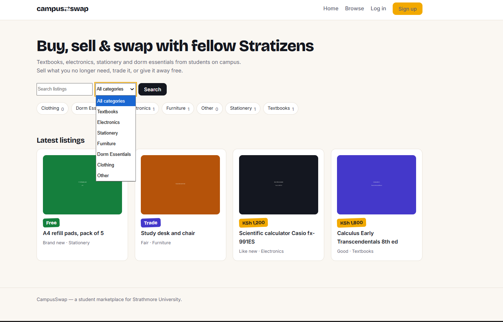

# CampusSwap



A student-only marketplace for Strathmore University.

Students end every semester with textbooks, calculators, hotplates and furniture they no longer
need, and the usual option is a WhatsApp group where posts scroll away in minutes. CampusSwap gives
Stratizens one place to list those items — to **sell**, **trade** or **give away free** — and to
browse what other students are offering. A student signs up with their Strathmore email, posts an
item with a photo, price and a campus meet-up spot, browses or searches what others have listed, and
contacts a seller on WhatsApp to arrange the hand-over.

Individual semester project for BBT 3101 (Internet Programming with Django)
by Andrew Karanja (167144).

## Stack

- Python 3.12+, Django 6.1
- SQLite in development (PostgreSQL planned for deployment)
- Server-rendered Django templates, one hand-written CSS file, no build step
- Django REST Framework + drf-spectacular for the JSON API and its OpenAPI docs
- Pillow for image handling, python-dotenv for settings

## Features

**Accounts and authentication**

- Sign up restricted to configured email domains (default `strathmore.edu`), with a friendly error
- Log in with **either** email address or username, case-insensitively
- "Keep me logged in" controls how long the session lasts
- Logout as a POST form (Django 5+ removed GET logout)
- Password change and the full four-step password reset flow (email to the console in development)
- Public student profile (avatar or initials, course, year, bio, member since, their listings) and a
  private profile editor

**Marketplace**

- Post a listing with photos, category, condition, meet-up spot and a Sell / Trade / Free type
- Price rules per type: selling needs a price, trading needs what you want in exchange, free has no price
- Up to five photos per listing through an inline formset, reordered by arrow buttons or dragging;
  the first photo is the cover shown on cards
- Every upload is downscaled to 1600px and re-encoded without EXIF metadata (so no stray GPS data)
- Listing detail page with a photo gallery (thumbnails, arrow-key navigation, `<dialog>` lightbox),
  the price tag, badges, seller card and a WhatsApp contact link for logged-in students
- Edit, delete and mark a listing Available / Reserved / Sold — owner only
- "My listings" with status tabs and counts
- `/browse/` — search across title and description, filter by category, type, condition and price
  range, sort by newest or price, 12 per page with the filters kept across pages, removable
  active-filter chips, and a filter sidebar that becomes a bottom sheet on mobile
- Category pages at `/c/<slug>/` reuse the same view, with the category fixed by the URL
- Sold items are hidden by default, with an "Include sold items" toggle
- Home hero search and category chips feed straight into the browse page
- A per-visitor "Recently viewed" strip driven by the session
- View counter that does not count the owner's own visits

**REST API**

- `/api/v1/` — categories (read-only) and listings (search, filter, paginate, retrieve, and
  create/edit/delete your own), JSON only
- The same search form drives the API filters and the browse page, and the same
  `Listing.clean()` enforces the Sell / Trade / Free price rules, so the two interfaces cannot
  drift apart
- Session cookie or API token (`POST /api/v1/auth/token/`, then `Authorization: Token <key>`)
- Interactive Swagger UI at `/api/docs/`, served from the project's own static files so it needs
  no exception in the Content-Security-Policy

**Admin and demo data**

- Custom user admin with the student profile fields
- Listing admin with thumbnails, filters, search, inline status editing and the photo gallery
  as a `TabularInline`
- Seven categories seeded by a data migration, plus a `seed_demo` command that generates
  placeholder photos with Pillow

## Requirements coverage

### Models

| Requirement                  | Where                                                                                                                                                                                                           |
| ---------------------------- | --------------------------------------------------------------------------------------------------------------------------------------------------------------------------------------------------------------- |
| Custom user model            | `accounts/models.py` → `User(AbstractUser)`, with `AUTH_USER_MODEL = "accounts.User"` in `config/settings.py`                                                                                                   |
| Field types and options      | `accounts/models.py` (`EmailField(unique=True)`, `ImageField`, `PositiveSmallIntegerField` with choices); `products/models.py` (`DecimalField`, `SlugField`, `TextField`, `ImageField`, `PositiveIntegerField`) |
| Validators                   | `accounts/models.py` → `kenyan_phone_validator` (`RegexValidator`); `products/models.py` → `MinValueValidator(0)` on `price`                                                                                    |
| Choices                      | `products/models.py` → `Listing.Condition`, `Listing.ListingType`, `Listing.Status` (all `TextChoices`)                                                                                                         |
| One-to-many relationships    | `products/models.py` → `Listing.seller` (FK to `AUTH_USER_MODEL`, `CASCADE`, `related_name="listings"`), `Listing.category` (FK `PROTECT`) and `ListingImage.listing` (FK `CASCADE`, `related_name="images"`) |
| Many-to-many through a table | `products/models.py` → `SavedListing` (user + listing) with a `UniqueConstraint` on the pair                                                                                                                    |
| Model-level validation       | `products/models.py` → `Listing.clean()` (Sell/Trade/Free price rules); `accounts/models.py` → `User.clean()` (normalises the phone to `+254…`)                                                                 |
| Meta options and indexes     | `products/models.py` → `Listing.Meta.ordering`, two `models.Index` entries; `Category.Meta.ordering`                                                                                                            |
| Model methods and properties | `__str__`, `get_absolute_url`, `Listing.display_price`, `Listing.is_available`, `User.display_name`, `User.initials`                                                                                            |
| Custom `save()`              | `products/models.py` → `Listing.save()` builds a unique slug from the title plus a random suffix                                                                                                                |
| Data migration               | `products/migrations/0002_seed_categories.py`; `products/migrations/0004_move_cover_image_to_gallery.py` moves each listing's single image into the gallery as its cover, then drops `Listing.image`            |
| Management command           | `products/management/commands/seed_demo.py`                                                                                                                                                                     |

> Note on where validation runs: `Model.clean()` is **not** called by `save()`. It runs when something
> calls `full_clean()` — which `ModelForm` does during its `_post_clean()` step, and which the admin
> and `seed_demo` do too. Code that calls `Listing.objects.create(...)` directly bypasses it, which is
> why the rules are also expressed as database-level field options (`null`, `blank`, validators).

### Forms

| Requirement                        | Where                                                                                                                                                                                     |
| ---------------------------------- | ----------------------------------------------------------------------------------------------------------------------------------------------------------------------------------------- |
| `ModelForm`                        | `products/forms.py` → `ListingForm`; `accounts/forms.py` → `ProfileForm`                                                                                                                  |
| `ModelForm` subclassing a built-in | `accounts/forms.py` → `SignUpForm(UserCreationForm)`                                                                                                                                      |
| Plain `forms.Form`                 | `products/forms.py` → `ListingSearchForm` (GET search, saves nothing; `filter(queryset)` applies `Q` objects, range filters and sorting, `clean()` checks min ≤ max, `active_filters()` drives the chips) |
| Field-level custom validation      | `accounts/forms.py` → `SignUpForm.clean_email()` (lowercases, case-insensitive uniqueness, domain restriction)                                                                            |
| Cross-field validation             | `products/models.py` → `Listing.clean()`, surfaced on the `price` / `trade_for` inputs by `ListingForm`; `products/forms.py` → `ListingForm.clean()` mirrors the "free has no price" rule |
| Inline formset                     | `products/forms.py` → `ListingImageFormSet` via `inlineformset_factory` (`can_order`, `can_delete`, `max_num=5`, `validate_max`) with `BaseListingImageFormSet.clean()` requiring at least one photo; saved by `PhotoFormsetMixin` in `products/views.py` |
| File-upload validation             | `products/forms.py` → `ListingImageForm.clean_image()` (max 5 MB, min 400px, must open in Pillow); `products/imaging.py` → `process_upload()` downscales and strips EXIF; `accounts/forms.py` → `ProfileForm.clean_avatar()` (max 2 MB) |
| Widgets and labels                 | `products/forms.py` → `RadioSelect` segmented buttons for `listing_type` and `condition`, `Textarea`, placeholders                                                                        |
| Shared form styling                | `config/forms.py` → `FormStyleMixin` adds the CSS classes and an error class to every widget                                                                                              |
| Shared field rendering             | `templates/includes/form_field.html` (label, widget, help text, errors, required marker)                                                                                                  |

### Authentication

| Requirement                      | Where                                                                                                                                                                                        |
| -------------------------------- | -------------------------------------------------------------------------------------------------------------------------------------------------------------------------------------------- |
| Registration                     | `accounts/views.py` → `signup()`; `accounts/forms.py` → `SignUpForm`                                                                                                                         |
| Email-domain restriction         | `config/settings.py` → `ALLOWED_SIGNUP_EMAIL_DOMAINS` (read from `.env`; empty means allow any)                                                                                              |
| Login with email **or** username | `accounts/backends.py` → `EmailOrUsernameBackend`, registered in `AUTHENTICATION_BACKENDS` ahead of `ModelBackend`                                                                           |
| Login view and form              | `accounts/views.py` → `CampusLoginView`; `accounts/forms.py` → `LoginForm`                                                                                                                   |
| Logout via POST                  | `accounts/urls.py` → `LogoutView`, posted from the navbar form in `templates/base.html` with ``                                                                              |
| Password change                  | `accounts/urls.py` → `PasswordChangeView` / `PasswordChangeDoneView`                                                                                                                         |
| Password reset (4 views)         | `accounts/urls.py` → `PasswordResetView`, `PasswordResetDoneView`, `PasswordResetConfirmView`, `PasswordResetCompleteView`; templates in `templates/registration/`                           |
| Development email backend        | `config/settings.py` → `MAILERS["default"]` console backend (the current Django 6.1 API; `EMAIL_BACKEND` is deprecated)                                                                      |
| Login-required views             | `accounts/views.py` → `ProfileUpdateView(LoginRequiredMixin, …)`; `products/views.py` → `ListingCreateView`, `MyListingsView`, `OwnerListingMixin`                                           |
| Ownership enforcement            | `products/views.py` → `OwnerListingMixin.get_queryset()` filters to `seller=request.user`, so a non-owner gets a 404 on edit/delete; `mark_status()` is `@require_POST` with the same filter |
| Auth redirect settings           | `config/settings.py` → `LOGIN_URL`, `LOGIN_REDIRECT_URL`, `LOGOUT_REDIRECT_URL`                                                                                                              |
| Password hashing and validators  | Django defaults, with `AUTH_PASSWORD_VALIDATORS` in `config/settings.py`                                                                                                                     |

### Sessions

| Requirement                         | Where                                                                                                                                                                                                                                                                                          |
| ----------------------------------- | ---------------------------------------------------------------------------------------------------------------------------------------------------------------------------------------------------------------------------------------------------------------------------------------------- |
| Session middleware                  | `config/settings.py` → `django.contrib.sessions.middleware.SessionMiddleware` in `MIDDLEWARE`, with `django.contrib.sessions` installed (sessions stored in the database)                                                                                                                      |
| Session-based login                 | `accounts/views.py` → `CampusLoginView`; `django.contrib.auth.login()` writes the user id into `request.session` and cycles the session key to prevent fixation                                                                                                                                |
| "Remember me" session expiry        | `accounts/forms.py` → `LoginForm.remember_me`; `accounts/views.py` → `CampusLoginView.form_valid()` calls `request.session.set_expiry(0)` (ends when the browser closes) or `set_expiry(None)` to fall back to `SESSION_COOKIE_AGE` = 2 weeks in `config/settings.py`                          |
| Recently viewed listings            | `products/views.py` → `remember_viewed()` and `recently_viewed_listings()` store the last `RECENTLY_VIEWED_LIMIT` (5) listing ids under the `recently_viewed` session key, most recent first, no duplicates, skipping the visitor's own listings; rendered as a strip in `templates/home.html` |
| Messages framework (session-backed) | `django.contrib.messages` rendered as toasts in `templates/base.html`                                                                                                                                                                                                                          |

### APIs

| Requirement                | Where                                                                                                                                                                      |
| -------------------------- | -------------------------------------------------------------------------------------------------------------------------------------------------------------------------- |
| Serializers                | `api/serializers.py` → `CategorySerializer`, `ListingSerializer` (nested category, seller and photo URLs for reading; `category_id` for writing), `ListingImageSerializer` |
| Validation reuse           | `api/serializers.py` → `ListingSerializer.validate()` builds the listing the request would save and calls `Listing.clean()`, the same rules the web form gets for free     |
| ViewSets and routers       | `api/views.py` → `CategoryViewSet` (read-only), `ListingViewSet`; `api/urls.py` → `DefaultRouter`                                                                          |
| Search, filter, paginate   | `api/filters.py` → `ListingSearchBackend` hands the query string to `products.forms.ListingSearchForm`; `ListingPagination` is 12 per page, `page_size` up to 50           |
| Custom permission          | `api/permissions.py` → `IsOwnerOrReadOnly` (anyone reads, only `listing.seller` writes)                                                                                    |
| Authentication             | `config/settings.py` → `REST_FRAMEWORK`: `TokenAuthentication` then `SessionAuthentication`; `api/views.py` → `ApiTokenView`                                                |
| OpenAPI documentation      | drf-spectacular: schema at `/api/schema/`, Swagger UI at `/api/docs/`                                                                                                      |
| Tests                      | `api/tests.py` (endpoint behaviour) and `config/tests_security.py` → `ApiAccessTests` (the permission matrix)                                                               |

#### Endpoints

| Method                   | Path                        | Who                   |
| ------------------------ | --------------------------- | --------------------- |
| `GET`                    | `/api/v1/categories/`       | anyone                |
| `GET`                    | `/api/v1/categories/<slug>/`| anyone                |
| `GET`                    | `/api/v1/listings/`         | anyone                |
| `GET`                    | `/api/v1/listings/<slug>/`  | anyone                |
| `POST`                   | `/api/v1/listings/`         | any signed-in student |
| `PUT` `PATCH` `DELETE`   | `/api/v1/listings/<slug>/`  | the seller only       |
| `POST`                   | `/api/v1/auth/token/`       | anyone with a password|

List filters: `q`, `category` (slug or id), `listing_type`, `condition`, `min_price`, `max_price`,
`sort`, `show_sold`, `page`, `page_size`. Photo uploads are deliberately not in the API — they go
through the web form, which re-encodes and strips metadata from every file.

```powershell
# Browse, no account needed
curl "http://127.0.0.1:8000/api/v1/listings/?q=calculator&max_price=2000"

# Get a token, then post a listing as yourself
curl -X POST http://127.0.0.1:8000/api/v1/auth/token/ `
  -H "Content-Type: application/json" `
  -d '{\"username\": \"wanjiku\", \"password\": \"campus123!\"}'

curl -X POST http://127.0.0.1:8000/api/v1/listings/ `
  -H "Authorization: Token <key>" -H "Content-Type: application/json" `
  -d '{\"title\": \"Lab coat\", \"description\": \"Size M.\", \"category_id\": 1,
       \"condition\": \"GOOD\", \"listing_type\": \"FREE\", \"meetup_spot\": \"Phase 2\"}'
```

## Setup (Windows / PowerShell)

```powershell
git clone https://github.com/Karashee/campus-swap.git
cd campus-swap

python -m venv .venv
.venv\Scripts\activate

pip install -r requirements.txt

# Create your own .env from the template
copy .env.example .env

# Generate a SECRET_KEY and paste it into .env
python -c "from django.core.management.utils import get_random_secret_key; print(get_random_secret_key())"

python manage.py migrate
python manage.py seed_demo
python manage.py createsuperuser
python manage.py runserver
```

The site runs at http://127.0.0.1:8000/ and the admin at http://127.0.0.1:8000/admin/.

### Environment variables

Set these in `.env` (see `.env.example`):

| Variable                       | Purpose                                                             |
| ------------------------------ | ------------------------------------------------------------------- |
| `SECRET_KEY`                   | Django secret key. Generate your own; never reuse one from a repo.  |
| `DEBUG`                        | `True` in development, `False` in production.                       |
| `ALLOWED_HOSTS`                | Comma-separated host names, e.g. `127.0.0.1,localhost`.             |
| `ALLOWED_SIGNUP_EMAIL_DOMAINS` | Comma-separated domains allowed to sign up. Empty means any domain. |

`.env`, `db.sqlite3` and `/media/` are gitignored.

### Demo logins

`python manage.py seed_demo` creates two students and six listings across all three listing types.
Pass `--reset` to clear and recreate them.

| Username  | Email                           | Password     |
| --------- | ------------------------------- | ------------ |
| `wanjiku` | `wanjiku.mwangi@strathmore.edu` | `campus123!` |
| `brian`   | `brian.otieno@strathmore.edu`   | `campus123!` |

Either username or email works at the login form.

## Tests

```powershell
python manage.py test          # 189 tests
python manage.py check
```

**189 tests** covering: the email-domain restriction and case-insensitive duplicate emails, login by
email and by username, remember-me session expiry, POST-only logout, login-required views, listing
validation per type, ownership (404 for non-owners on edit, delete and status changes), the view
counter skipping the owner, search filtering, the recently-viewed session behaviour, the photo
formset and upload re-encoding, the site-wide security audit in `config/tests_security.py` (every
named URL is listed in one of its permission tables, or the suite fails), and the JSON API in
`api/tests.py`.
